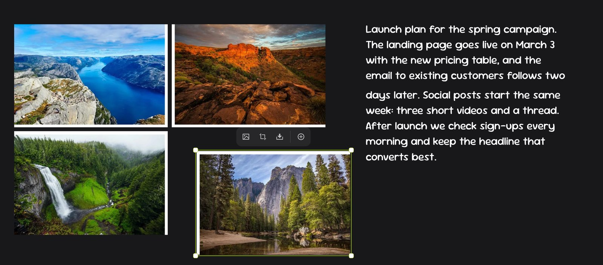
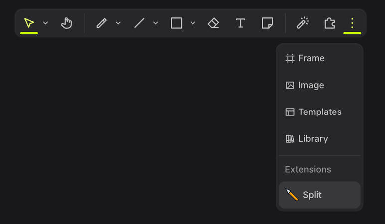
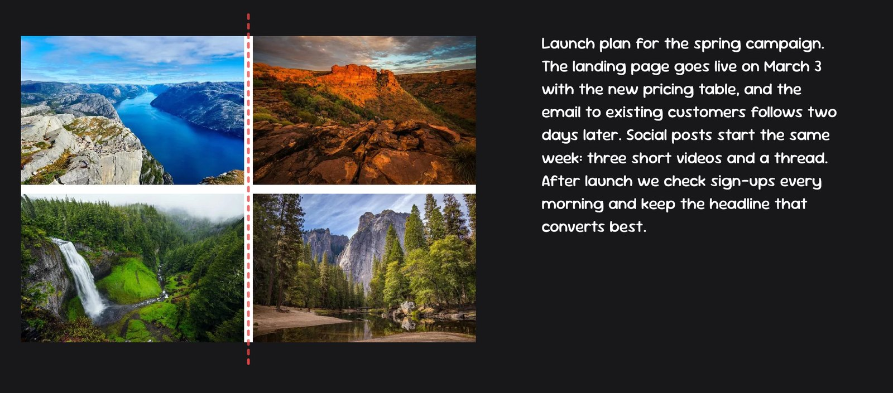
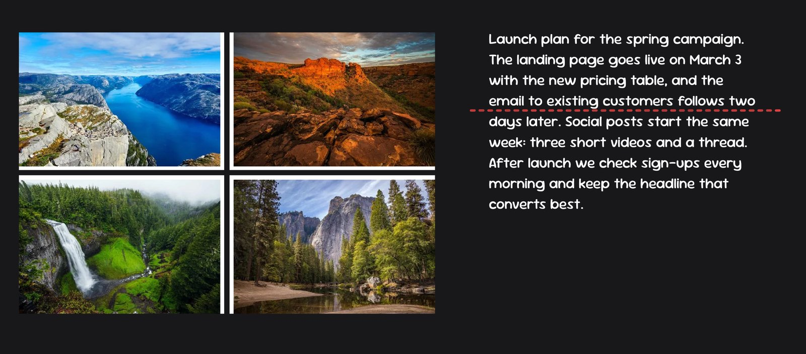

# Split

Cut images, text and rectangles on your board in two by dragging a straight line across them.

## What you can cut

- **Images.** Each piece becomes its own image showing its part of the picture. Turn a grid of photos into separate photos, or cut a screenshot down to the parts you need. You can cut a piece again.
- **Text.** Write one long paragraph, then split it into two text boxes between any two lines. Both keep the font, size and color.
- **Rectangles.** Get two rectangles with the same color, border and label.

## How to use it

1. Open the **⋮** menu in the toolbar and pick **Split** under **Extensions**. Your cursor turns into a box cutter.

    

2. Press and drag across what you want to cut. A red dashed line shows where the cut will go. It is always horizontal or vertical: whichever direction you drag further decides which.

    

3. Let go. Everything the line crosses is cut in two, and the second piece moves a few pixels away from the first so you can see the cut.

    

To split text, drag a horizontal line between two lines of it. The cut moves to the nearest gap between lines, so it never goes through a word.

When you're done, pick another tool, such as **Select**, to stop cutting.

## Good to know

- **Undo** a cut by pressing undo twice.
- **Text** can only be cut horizontally. Bold, italic and links are removed from both halves.
- **Rotated or locked** elements are not cut.
- **Very thin pieces** are not made: if the line is closer than a few pixels to an edge, that element is left alone.
- **Other elements** are not cut: circles, diamonds, sticky notes, lines, arrows and drawings.
- **People on the board with you** see the cut pieces like any other edit.

## Permissions

Split asks for **Scene** access. It uses it to find the elements under your cut line and to cut them. It does not read anything else, and nothing leaves your board.
